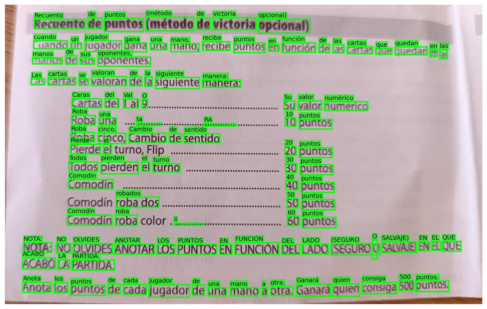
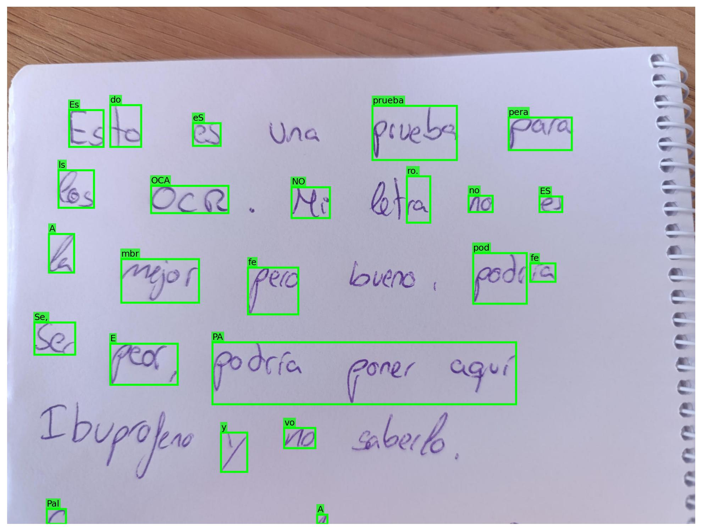

## Práctica 4b. Reconocimiento de caracteres en matrículas

### Contenidos

[Tarea](#41-aspectos-cubiertos)  
[OCRs](#42-ocrs-clásicos)  
[VLMs](#43-vlms)  
[Entrega](#44-entrega)

<!-- MOdelos VLM para OCR https://florence-2.com  -->

## 4.0 Sobre la práctica 4

Esta práctica se compone de dos tareas diferentes, detección y OCR. En este README se explica la segunda tarea, el OCR, para leer sobre la primera ir a la carpeta *P4*. Ambas tareas se entregan juntas, en el mismo GitHub, ya que serán evaluadas conjuntamente.

## 4.1 Aspectos cubiertos

En esta práctica se aborda el uso de modelos existentes para el reconocimiento de texto, el objetivo es el de expandir el detector de coches y matrículas para que sea capaz de **reconocer los caracteres en las matrículas visibles** y así ser capaces de identificar el coche correctamente.

En la actualidad suele haber dos vías a la hora de plantear un modelo que realice reconocimiento óptico de caracteres (OCR). La primera sería usar una red neuronal especializada en detectar e identificar el texto en la imagen, mientras que la segunda correspondería a usar un modelo de lenguaje visual (VLM por sus siglas en inglés) como podrían ser GPT-4o o Gemini 2.5 para extraer directamente la información de la imagen. Estos VLM pueden estar o no fine-tuneados para realizar tareas de OCR. Estas dos maneras de enfocar el problema representan el clásico balance entre una solución rápida (red neuronal) y una solución con una potencial mayor tasa de acierto pero más costosa computacionalmente (VLM's).

En la práctica de hoy propondremos el uso de al menos dos modelos, uno de cada tipo, para hacer algunas comparaciones entre ellos y complementar la tarea de detección. El cuaderno *VC_P4b.ipynb* contiene ejemplos de algunos de los modelos que se plantean a continuación.

### 4.2 OCRs Clásicos

Como OCR's basados en redes neuronales clásicas, proponemos tres opciones: los clásicos Tesseract y easyOCR, y el más moderno PaddleOCR. Para los tres, el cuaderno *VC_P4b.ipynb* incluye demostradores mínimos. Otras posibilidades son [KERAS-OCR](https://github.com/faustomorales/keras-ocr), o [dots.ocr](https://github.com/rednote-hilab/dots.ocr), de los que no ilustramos su uso en este cuaderno.
<!-- Al ser un nuevo *environment* no olvidar  que es necesario instalar el paquete para ejecutar cuadernos, desde consola-->

Por un lado, el conocido [Tesseract](https://github.com/tesseract-ocr/tesseract), requiere desde python un *wrapper*, previa instalación.
La documentación de [Tesseract](https://tesseract-ocr.github.io/tessdoc/Installation.html) dispone de **información para su instalación en distintas plataformas**.
Para entorno WIdnows:

- Decargar los binarios desde el repositorio para tal fin de la [Universidad Manheim](https://github.com/UB-Mannheim/tesseract/wiki).
- Ejecutar el archivo descargado para lsu instalación
- Durante la instalación, he indicado que incluya datos de otros lenguajes, en mi caso español
- Anotar la ruta donde se instala, dado que debe especificarse en el código python. O añadir al *PATH*.
- Instalar el *wrapper* [pytesseract](https://pypi.org/project/pytesseract/) en el *environment* *VC_P4*:

```
pip install pytesseract
```

Por otro lado, [easyOCR](https://github.com/JaidedAI/EasyOCR) ofrece soporte para más de 80 lenguas. Su instalación es a priori más simple, basta con:

```
pip install easyocr
```

Pero surge una **incidencia** con OpenCV, dado que funciones de visualización, como *imshow*, dejan de estar presentes. Observando la incompatibilidad entre la instalación de YOLO y easyOCR,
puedes llegar a un punto en que la instalación de OpenCV no sea completa para nuestro cuaderno. Lo hemos conseguido resolver con:

```
pip uninstall opencv-python opencv-python-headless
pip install opencv-python --upgrade
```

Por último, [PaddleOCR](https://github.com/PaddlePaddle/PaddleOCR) es la solución de OCR propuesta por la empresa china PaddlePaddle y ofrece, al igual que EasyOCR, soporte para más de 80 idiomas, incluyendo el Español. Su instalación consta de dos pasos, primero hay que instalar la librería de PaddlePaddle usando el comando que se corresponda a nuestra máquina en la [web oficial](https://www.paddlepaddle.org.cn/en/install/quick?docurl=/documentation/docs/en/develop/install/pip/windows-pip_en.html), de forma muy similar a torch. Posteriormente, se instala el OCR usando el comando en la consola:

```
pip install paddleocr
```


Importante tener en cuenta que habitualmente, tanto estos modelos como los VLMs especializados, estan optimizados para tratar con texto escrito a máquina, no manuscrito. En la siguiente imagen podemos ver la diferencia clara que tienen de rendimiento según el origen de la tipografía.

<table>
  <tr>
    <td align="center">
      <br>
      <sub>Resultado de Tesseract con texto a máquina</sub>
    </td>
  </tr>
  <tr>
    <td align="center">
      <br>
      <sub>Resultado de Tesseract con texto manuscrito</sub>
    </td>
  </tr>
</table>


### 4.3 VLMs

De entre los VLMs podemos seleccionar alguno que este explicitamente entrenado para esta tarea, como podría ser el [Unlimited-COR de Baidu]( https://github.com/baidu/Unlimited-OCR) o uno de uso general como [SmolVLM](https://huggingface.co/blog/smolvlm). Cuando se selecciona esta opción, hay que tener especial cuidado con la cantidad de recursos que necesitan para ser ejecutados en local, especialmente si no contamos con una GPU. 
Tanto SmolVLM como Unlimited-OCR, han sido escogidos por ser bastantes ligeros, permitiendo su uso en ordenadores no muy potentes. Para usarlos, tendremos que instalar principalmente dos librerias diferentes: torch, haciendo uso de la [web oficial](https://pytorch.org/get-started/locally/) para obtener el comando que se corresponda a nuestro PC, y la librería transformers de [HuggingFace](https://huggingface.co). La librería transformers nos permite descargar y usar fácilmente modelos entrenados por la comunidad en nuestro ordenador. Para su instalación simplemente:

```
pip install transformers
```

Otras posibilidades de modelos generales podrían ser los modelos de la familia [Idefics](https://huggingface.co/blog/idefics2) de la propia HuggingFace, [Florence-2](https://huggingface.co/microsoft/Florence-2-large) de Microsoft, [PaliGemma](https://huggingface.co/blog/paligemma2) de Google o [MiniCPM-V](https://github.com/openbmb/MiniCPM-V).

Otros VLM especializados en OCR son [Falcon-OCR](https://huggingface.co/tiiuae/Falcon-OCR) (en las pruebas que hemos hecho este solo funciona en linux, igual ustedes tienen más maña) o [PaddleOCR-VL](https://huggingface.co/PaddlePaddle/PaddleOCR-VL).


### 4.4 Entrega

La segunda entrega de la práctica 4 consistirá en dos tareas:

- Completar la tarea planteada en el apartado de detección con la adquisición del texto de cada matrícula detectada y su posterior guardado en el csv.

- Realizar una comparativa entre dos OCR, uno clásico y un VLM, en términos de tiempo de inferencia y tasa de acierto, usando la base de datos de detección de matrículas completándola con el texto si faltase.


La **entrega** se hará junto a la de la anterior práctica, incluyendo en el vídeo de test una visualización de la matrícula leída y en el csv de volcado una columna con la matrícula correspondiente. La comparativa deberá hacerse dentro del propio README, incluyendo gráficas de tiempos y rendimiento, así como unas pequeñas conclusiones. 

Unos consejos en vista a años anteriores:

- La comparativa entre los modelos tiene que ser en base a métricas.

- La condiciones del experimento tienen que ser las mismas para todos los modelos evaluados. 

- Usen un número mínimo de imágenes para realizar la comparativa.

- Poned las especificaciones de la máquina en que se hyan hecho las pruebas, los tiempos de inferencia pueden variar mucho según el equipo.


***
Bajo licencia de Creative Commons Reconocimiento - No Comercial 4.0 Internacional

